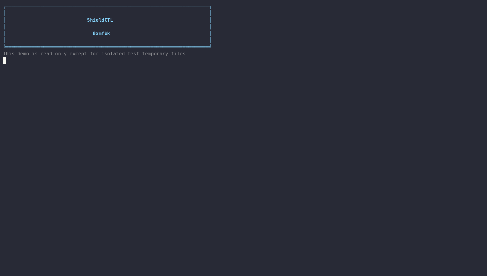

<div align="center">

# 🛡️ ShieldCTL

### Practical Linux hardening, auditing, and integrity monitoring

Secure your baseline. Understand every change. Keep control.

<p>
  <a href="https://github.com/0xmfbk/ShieldCTL">
    
  </a>
  <a href="https://www.gnu.org/software/bash/">
    
  </a>
  <a href="./LICENSE">
    
  </a>
</p>

<p><strong>Built by 0xmfbk</strong> • A transparent, reversible security toolkit for Linux administrators</p>

<p>
  
</p>

</div>

ShieldCTL is a single-file Linux hardening, auditing, integrity-monitoring, and
scheduling utility. It applies conservative security improvements, explains what it
finds, records task results, and keeps changes easy to review and undo.

It is designed for administrators who want a practical command-line security baseline
without installing a permanent ShieldCTL daemon or sending data to an external service.

> **Important:** shieldctl reduces attack surface and improves visibility. It does not
> make a system invulnerable. Read the changes, test with `--dry-run`, and keep a
> recovery path before applying hardening to a production machine.

## Highlights

- Kernel and network hardening through tested `sysctl` values
- Conservative kernel-module blocking
- Core-dump restrictions
- Safer permissions for selected security-sensitive paths
- Optional firewall, USBGuard, umask, and service hardening
- Lynis, rkhunter, ClamAV, AIDE, update, and network-listener checks
- AIDE baseline hashing to detect baseline tampering
- Reversible drop-in files, backups, manifests, and rollback support
- systemd timer scheduling with a strict task allowlist
- Human-readable status, reports, logs, exit codes, and desktop notifications
- No shieldctl daemon and no shieldctl-owned network service

## Requirements

- Linux with Bash 4+
- `systemd` is recommended for service checks, scheduling, and background AIDE jobs
- Root access for hardening, installation, scans, rollback, and schedules
- One supported package manager for installation:
  - `apt-get` — Debian, Ubuntu, Pop!_OS, Linux Mint, and derivatives
  - `dnf` — Fedora and compatible distributions
  - `pacman` — Arch Linux and derivatives
  - `zypper` — openSUSE and compatible distributions

Most checks degrade gracefully when optional tools are unavailable. The strongest
integration is expected on Debian-family systems; Fedora, Arch, and openSUSE use
best-effort package and service mappings.

## Docker test prerequisites

Docker is **not installed automatically by shieldctl**. Installing a system
container runtime requires administrator approval and distribution-specific
repository configuration. Install Docker only if you want to run the optional
container test harness.

Check whether Docker and Compose are already available:

```bash
docker --version
docker compose version
```

If either command is missing, install Docker using your distribution's official
packages or documentation.

### Debian, Ubuntu, and Pop!_OS

```bash
sudo apt-get update
sudo apt-get install -y docker.io docker-compose
sudo systemctl enable --now docker
sudo usermod -aG docker "$USER"
```

Apply the group change by logging out and back in, or run:

```bash
newgrp docker
```

### Fedora

```bash
sudo dnf install -y docker docker-compose-plugin
sudo systemctl enable --now docker
sudo usermod -aG docker "$USER"
newgrp docker
```

### Arch Linux

```bash
sudo pacman -S --needed docker docker-compose
sudo systemctl enable --now docker
sudo usermod -aG docker "$USER"
newgrp docker
```

### openSUSE

```bash
sudo zypper install docker docker-compose
sudo systemctl enable --now docker
sudo usermod -aG docker "$USER"
newgrp docker
```

Verify the installation before running the project tests:

```bash
docker --version
docker compose version
docker run --rm hello-world
```

If `docker compose version` is unavailable but `docker-compose --version`
works, use `docker-compose` in the commands below. Debian 13 commonly provides
the standalone `docker-compose` command from its default repositories.
Alternatively, install Docker's official Compose plugin.

Do not run the test harness with `sudo` unless your Docker installation
specifically requires it.

## Installation

From a checkout:

```bash
chmod +x shieldctl
sudo ./shieldctl self-install
sudo shieldctl install
```

Install optional components:

```bash
sudo shieldctl install --firewall
sudo shieldctl install --usbguard
```

`install` may install Lynis, rkhunter, ClamAV, AIDE, fail2ban, auditd, and the
distribution-appropriate automatic-update package. Optional packages may require
additional distribution repositories.

## Safe first run

Always inspect the current state and preview changes first:

```bash
shieldctl status
sudo shieldctl harden --dry-run
```

When satisfied, apply the recommended baseline:

```bash
sudo shieldctl harden
sudo shieldctl status
```

For a disposable VM, snapshot the VM before testing. On a physical system, ensure
you have console access or a tested recovery route before changing firewall or
network settings.

### Hardening output and firewall safety

Hardening is intentionally verbose. Each module prints:

- What the module is about to change
- The files, kernel settings, services, or firewall actions involved
- Whether the step completed, was skipped, or failed
- A final count of requested, completed, and skipped/failed steps

Before enabling a firewall, shieldctl lists exposed TCP and UDP listeners,
including their address, protocol, port, and interface scope. It keeps listeners
closed unless they are explicitly approved:

```text
Allow incoming tcp/8080 from anywhere? [Y/N]
Allow incoming udp/51820 on wg0 from anywhere? [Y/N]
```

Answer `Y` only when the service should be reachable; `N` (or an invalid
non-interactive decision) keeps it closed. Duplicate listeners are deduplicated
by protocol, port, and interface. Interface-scoped listeners use interface
rules, while DHCP client listeners on link-local or loopback-like interfaces are
not offered because replies are covered by conntrack.

The server port of the current SSH session is always allowed automatically and
is never removed or overridden. Other SSH listeners are never opened by
`--yes` or a non-interactive run. If an SSH daemon listener is not approved,
the firewall step aborts safely and tells you to use `--allow-port`:

```bash
sudo shieldctl harden firewall --allow-port 22/tcp
```

Explicit ports can be repeated. They are allowed without prompting:

```bash
sudo shieldctl harden firewall \
  --allow-port 22/tcp \
  --allow-port 51820/udp
```

`--yes` never opens discovered ports; it only applies explicit
`--allow-port` values and the current SSH-session protection. In dry-run and
test mode, no prompts occur and the exact firewall commands are printed.
UFW rules are added before default-deny is enabled. firewalld interface rules
use rich rules on a best-effort basis. Rollback intentionally leaves the
firewall enabled.

## Command reference

### Status and reporting

```bash
shieldctl status
sudo shieldctl report
```

`status` is a dashboard, not a guarantee. It reports encryption, Secure Boot,
firewall state, AppArmor/SELinux, services, AIDE, kernel settings, listeners,
pending updates, reboot state, and recent runs.

Disk encryption is intentionally informational. shieldctl does **not** convert an
existing root disk because an incorrect conversion can destroy data or leave the
system unbootable. Choose LUKS or another supported encryption option during OS
installation, or use a distro-specific migration procedure with a verified backup.

### Hardening

```bash
sudo shieldctl harden
sudo shieldctl harden --dry-run
sudo shieldctl harden sysctl modules coredump perms firewall
sudo shieldctl harden umask
sudo shieldctl harden usbguard
sudo shieldctl harden all
```

The default modules are:

| Module | Purpose |
|---|---|
| `sysctl` | Applies supported kernel and network hardening values |
| `modules` | Blocks selected obsolete or high-risk kernel modules |
| `coredump` | Restricts traditional and systemd core dumps |
| `perms` | Tightens selected permissions without making them looser |
| `firewall` | Enables/configures UFW or firewalld when available |

Opt-in modules:

| Module | Purpose |
|---|---|
| `umask` | Sets the login default umask to `027` |
| `usbguard` | Generates a USB policy and refuses unsafe replacement by default |

The `all` shortcut includes `umask`, but does not enable USBGuard
automatically because USB policy mistakes can affect keyboards and other devices.

### Rollback

```bash
sudo shieldctl rollback
```

Rollback removes shieldctl-managed drop-ins and restores recorded file permissions,
backups, and service states. Runtime sysctl values remain active until reboot unless
changed separately. The firewall is deliberately left enabled; disable it manually
only after confirming an alternative firewall is active.

### Security scans

```bash
sudo shieldctl scan updates
sudo shieldctl scan ports
sudo shieldctl scan rootkit
sudo shieldctl scan malware
sudo shieldctl scan integrity
sudo shieldctl scan audit
sudo shieldctl scan all
```

Scan results are written under `/var/log/shieldctl` and summarized in the run history
under `/var/lib/shieldctl`. Malware scanning checks user Downloads when a desktop
user is discoverable, plus `/tmp` and `/var/tmp`; provide explicit paths when needed:

```bash
sudo shieldctl scan malware --path /home/alice/Downloads --path /srv/uploads
```

### AIDE integrity workflow

```bash
sudo shieldctl aide init
sudo shieldctl aide check
sudo shieldctl aide update --no-accept
sudo shieldctl aide accept
```

Recommended workflow:

1. Build a baseline after verifying the system is trusted.
2. Run `aide check`.
3. Review changes and the generated log.
4. Accept a new baseline only when every change is understood.

To run a long operation through systemd:

```bash
sudo shieldctl aide init --bg
journalctl -fu shieldctl-aide-init
```

### Services

```bash
shieldctl services list
sudo shieldctl services disable avahi-daemon
```

Only explicitly named services are changed. Each disable operation asks for
confirmation unless `--yes` is supplied and records the previous enabled state.

### Scheduling

Install the binary first so timers use a stable path:

```bash
sudo shieldctl schedule defaults
sudo shieldctl schedule add weekly-malware "scan malware" "Sun *-*-* 03:00"
shieldctl schedule list
sudo shieldctl schedule run weekly-malware
sudo shieldctl schedule remove weekly-malware
```

Allowed scheduled tasks are limited to:

```text
scan audit
scan rootkit
scan malware
scan integrity
scan updates
scan ports
scan all
status
```

`aide update` is intentionally not schedulable. Baseline changes require human
review and explicit acceptance.

### Self-management

```bash
sudo shieldctl self-install
sudo shieldctl self-uninstall
```

Uninstall removes the installed binary and shieldctl timers. Hardening files remain
until `sudo shieldctl rollback` is run.

## Global options

| Option | Meaning |
|---|---|
| `-n`, `--dry-run` | Preview changes without writing or applying them |
| `-y`, `--yes` | Answer safety confirmations positively |
| `--allow-port PORT/PROTO` | Allow a firewall port without prompting; repeatable, e.g. `22/tcp` |
| `-q`, `--quiet` | Suppress normal output; useful for timers |
| `--path DIR` | Add a malware-scan path; repeatable |
| `--bg` | Run an AIDE operation through systemd |
| `--no-accept` | Keep an AIDE update as a reviewable new database |
| `-h`, `--help` | Show command help |
| `-v`, `--version` | Print the version |

## Files and state

By default, shieldctl uses:

| Path | Contents |
|---|---|
| `/var/lib/shieldctl` | Manifest, backups, permissions, service state, run history |
| `/var/log/shieldctl` | Task logs |
| `/etc/sysctl.d/99-shieldctl.conf` | Managed kernel settings |
| `/etc/modprobe.d/shieldctl-blacklist.conf` | Managed module rules |
| `/etc/security/limits.d/99-shieldctl-nocore.conf` | Core-dump limit |
| `/etc/systemd/coredump.conf.d/shieldctl.conf` | systemd core-dump policy |
| `/etc/systemd/system/shieldctl-*.{service,timer}` | Scheduled task units |

For isolated testing, the state and configuration roots can be overridden:

```bash
SHIELDCTL_ETC="$PWD/test-etc" \
SHIELDCTL_STATE="$PWD/test-state" \
SHIELDCTL_LOG="$PWD/test-log" \
sudo -E ./shieldctl harden --dry-run
```

## Design and safety boundaries

- Unsupported kernel keys are skipped rather than persisted.
- `ip_forward`, `kernel.modules_disabled`, and `usb-storage` are deliberately
  untouched because they can break virtualization, containers, drivers, or input.
- Permissions are only tightened by the permission module.
- USBGuard refuses to overwrite an existing policy unless explicitly authorized.
- Scheduled commands are allowlisted instead of accepting arbitrary shell code.
- Non-success scan results return non-zero and are recorded for systemd visibility.
- No cloud service, telemetry pipeline, or shieldctl network endpoint is required.

## Limitations

- Security tools can produce false positives and need administrator review.
- AIDE reports expected changes after package upgrades, configuration edits, and
  legitimate maintenance.
- Firewall rules can affect containers, virtual machines, discovery, and remote
  administration. Review local requirements first.
- Network listener detection reports exposure; it does not determine whether a
  service is safe.
- Automatic updates vary by distribution and may be unavailable or disabled by
  local policy.
- Root access is required for operations that inspect or modify protected resources.

## Development and validation

Basic syntax validation:

```bash
bash -n shieldctl
```

If installed, run ShellCheck before submitting changes:

```bash
shellcheck shieldctl
```

Test read-only behavior first:

```bash
./shieldctl --help
./shieldctl --version
./shieldctl status
./shieldctl services list
./shieldctl schedule list
```

### Container test harness

The repository includes a safe container harness for CLI, syntax, ShellCheck,
dry-run, isolated hardening-file, rollback, and distro-package checks:

```bash
docker compose build
docker compose run --rm debian
docker compose run --rm fedora
```

With standalone Compose:

```bash
docker-compose build
docker-compose run --rm debian
docker-compose run --rm fedora
```

The services use a read-only project mount, a read-only container filesystem,
temporary `/tmp` and `/run`, dropped Linux capabilities, and
`no-new-privileges`. They never mount the host `/etc`, `/var`, Docker socket,
host PID namespace, or host network.

Containers intentionally do **not** validate real host kernel changes, firewall
behavior, systemd activation, AppArmor/SELinux, USBGuard, disk encryption,
boot behavior, or physical/network recovery. Validate those in disposable VMs
with snapshots. Never add `privileged: true`, `network_mode: host`, `pid: host`,
or host `/etc` and `/var` mounts to this test harness.

## Contributing

Keep changes focused and conservative. Preserve the dry-run path, avoid destructive
defaults, quote shell expansions, return meaningful exit codes, and update this
README whenever commands, files, supported systems, or safety behavior change.

## License

shieldctl is released under the MIT License. See [LICENSE](./LICENSE).
